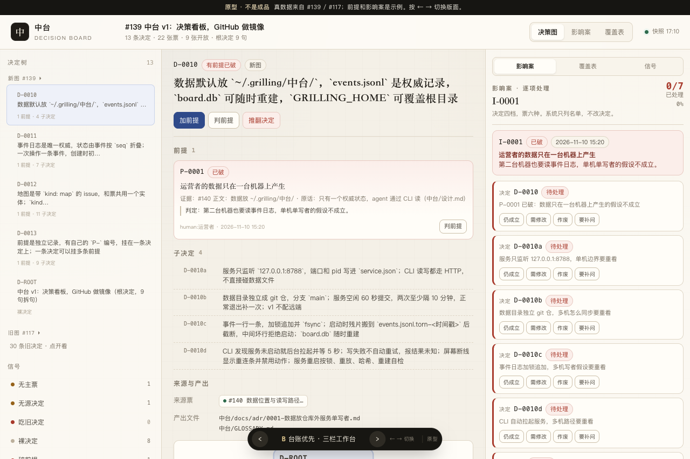
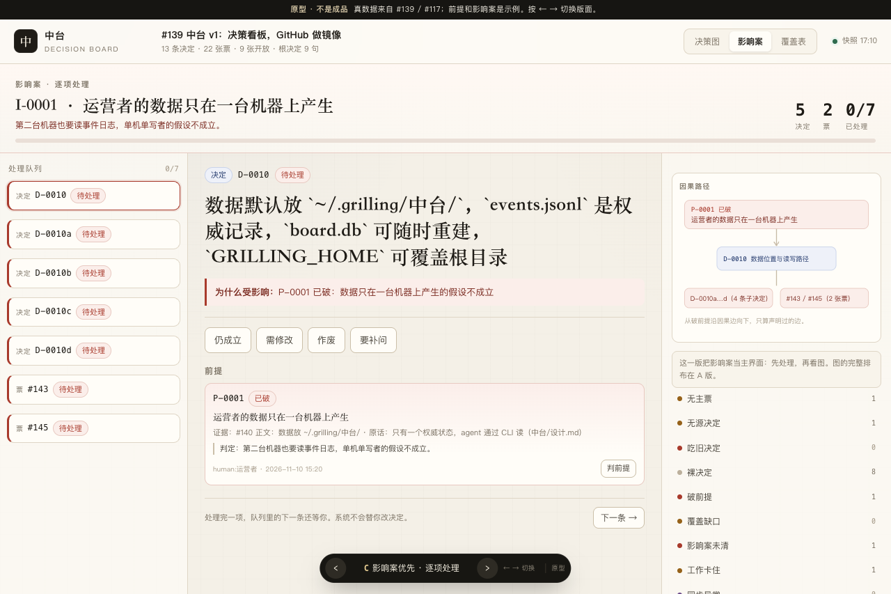

# #144 屏幕原型：决策图、影响案与视觉信号

一句话：用 #139 和 #117 的真数据做一个可点的屏幕原型，三个版面切换，给运营者判排布和九类视觉信号。

## 怎么开

双击 `prototype/issue-144/index.html`。零依赖、零构建、不联网。

也可以在本目录起静态服务：

```bash
python3 -m http.server 8791
# 打开 http://127.0.0.1:8791/
```

底部深色条是原型控制，不是产品 UI。按 ← → 或点箭头切换 A/B/C。

| 版面 | 主视图 | 适合判断 |
| --- | --- | --- |
| A 图优先 | 决策图铺满，右边详情抽屉，底部提醒条 | 节点和边的画法、图的密度、提醒条位置 |
| B 台账优先 | 左决定树、中详情、右影响案 / 覆盖表 / 信号 | 一屏能看多少信息、列表和详情怎么分 |
| C 影响案优先 | 一条一条处理受影响项，因果路径放旁边 | 破前提之后运营者的实际动作顺序 |

## 真数据和示例

- 决定、票、覆盖表来自 #139 地图和 #117 的 10 张旧票；旧台账 `docs/decisions.md` 的 30 条决定原文直接嵌入。
- 前提是示例，覆盖四种状态：P-0001 已破、P-0002 成立、P-0003 / P-0004 未知、P-0005 未验。
- 影响案 I-0001 是示例：P-0001 判破后圈出 D-0010 的 5 条决定和 #143 / #145。
- 工作状态是 2026-11-10 17:10 的 Orca 快照。关闭的票显示已完成；开放票按领取情况显示进行中、未领取或卡住。
- 九类信号里，无主票、无源决定、裸决定、破前提、影响案未清、工作卡住有真实对象；吃旧决定、覆盖缺口、同步异常当前是 0，点信号可以造一个示例看样式。
- 数据快照在 `data.js`，页面不联网。

## 交互

- 点节点看决定和前提；点票边看票的拆票理由、来源、产出和覆盖。
- 加前提、判前提、推翻决定、改票、改评论、新建票都有表单。保存只改内存，不写文件。
- 影响案里每条决定四档、每张票六种，点一下记处理，可以撤销。
- 覆盖表按拆句列票和状态；缺口用红色虚线标。
- 窄屏可以左右滑图，版面会堆叠。

## 三版截图

| A 图优先 | B 台账优先 | C 影响案优先 |
| --- | --- | --- |
|  |  |  |

破前提后在图上的范围，范围外压暗，触发边标红：


## 要你判的

1. `未知` 怎么画。设计稿的颜色表只写了未验、成立、已破三种。原型把 `未知` 画成琥珀色，和未验同色，靠标签区分。要不要单独一个颜色？
2. 票是边，开放票还没产出决定时画成「待产出」的 chip。这个画法读不读得懂？
3. 破前提之后，主界面先看图还是先看影响案队列？
4. 九类信号放在哪最顺手：A 顶部一行、B 左栏、C 右侧。现在三版都放了，位置不同。

## 不做什么

- 不接后端，不写事件日志，不改 GitHub。
- 不做真实同步、登录、权限。
- 不追求像素级成品。原型只回答排布、信号和交互形状。

## 关联

- 票：[屏幕原型：决策图、影响案与视觉信号](https://github.com/Lil-BobCN/grilling-remote/issues/144)
- 地图：[中台 v1：决策看板，GitHub 做镜像](https://github.com/Lil-BobCN/grilling-remote/issues/139)
- 参考：[地图 #117](https://github.com/Lil-BobCN/grilling-remote/issues/117)、[前提模型 ADR 0004](../../中台/docs/adr/0004-前提模型-状态判定与命令.md)
