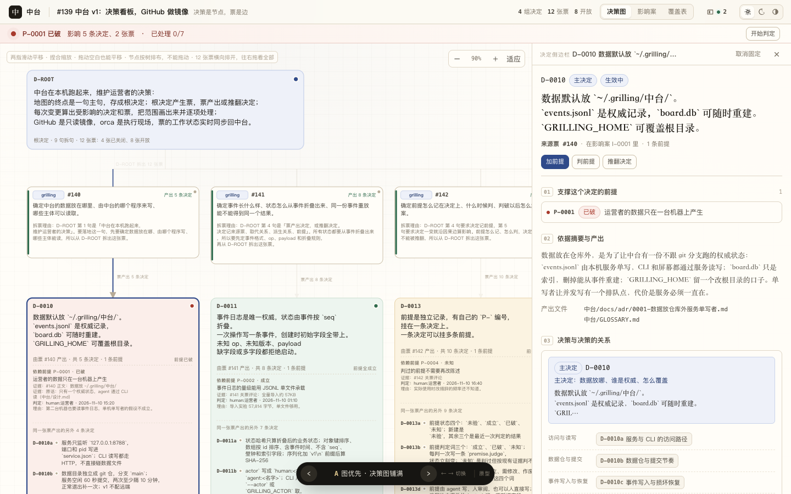
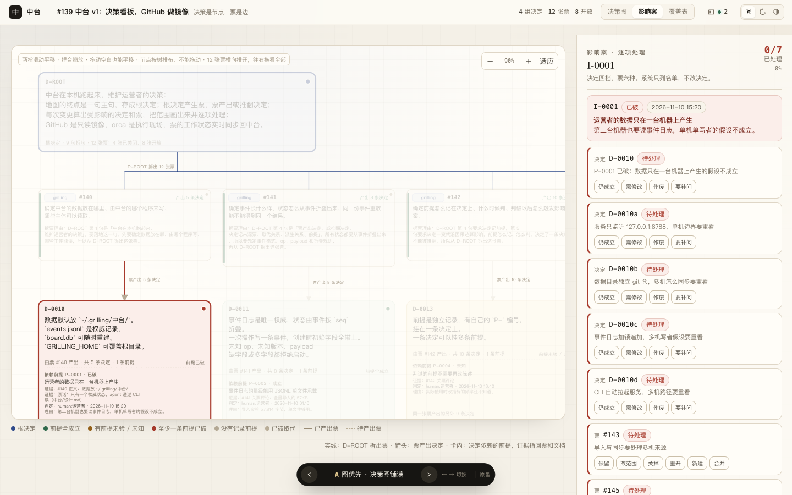

# #144 屏幕原型：决策图、影响案与视觉信号

一句话：用 #139、#117 和 #1 三张地图的真数据做一个可点的屏幕原型。票和决定分成两个侧边栏，顶部栏 44px 常驻，深浅两套主题。只保留图优先这一个版面。

## 怎么开

双击 `prototype/issue-144/index.html`。零依赖、零构建、不联网。

也可以在本目录起静态服务：

```bash
python3 -m http.server 8791
# 打开 http://127.0.0.1:8791/
```

顶部栏中间的 `#1` / `#139` 是地图切换，也可以用 ← →。原型只保留「图优先」这一个版面：决策图铺满，右边详情抽屉，破前提时顶部出提醒条。B 台账优先和 C 影响案优先两版已删除。

## 两张地图

| 地图 | 内容 | 怎么来的 |
| --- | --- | --- |
| #139 中台 v1 | 4 组新决定、12 张票，旧图 #117 的 30 条决定作为冻结带 | 手工整理，`data.js` |
| #1 客户需求 → 自动软件工厂 | 根决定 + 52 条决定 + 53 张票 | 从 #1 正文的 Decisions so far 和子票列表机械生成，`map1.js` |

- `?map=1` 直接打开 #1，不带参数默认 #139。
- #1 的票和 #139 共用同一套五段侧边栏。53 张票的 GitHub 正文已导入 `map1.js`，Question、Scope、Success、Blockers 解析进「要做什么」，「Evidence」段进「支撑证据」。拆票理由在 GitHub 上本来就没写，显示「导入的老票没有拆票理由」。
- #1 没有覆盖表和影响案，这两块入口在 #1 上会藏起来。
- #1 的决定正文是 GitHub 关票结论原文，逐字没改。7 条标「已被取代」，5 条标「部分已废」，都是原文里的说法。

## 真数据和示例

- 决定、票、覆盖表来自 #139 地图和 #117 的 10 张旧票；旧台账 `docs/decisions.md` 的 30 条决定原文直接嵌入。
- #1 的 52 条决定、53 张票来自 issue 正文和子票，由脚本生成，没有手工改字。
- 前提是示例，覆盖四种状态：P-0001 已破、P-0002 成立、P-0003 / P-0004 未知、P-0005 未验。
- 影响案 I-0001 是示例：P-0001 判破后圈出 D-0010 的 5 条决定和 #143 / #145。
- 工作状态是 2026-11-10 17:10 的 Orca 快照。关闭的票显示已完成；开放票按领取情况显示进行中、未领取或卡住。
- 九类信号里，无主票、无源决定、裸决定、破前提、影响案未清、工作卡住有真实对象；吃旧决定、覆盖缺口、同步异常当前是 0，点信号可以造一个示例看样式。
- 数据快照在 `data.js`，页面不联网。

## 交互

- 点票节点：右侧抽屉打开**票侧边栏**，按「怎么拆出来的 → 要做什么 → 产出了什么 → 证据 → 未定」五段排。
- 点决定节点：打开**决定侧边栏**，按「前提 → 依据摘要与产出 → 决策与决策的关系 → 影响 → 对话摘录 → 未定」六段排。开头先给决定全文，不用先读前提再猜结论。
- 票侧边栏只列产出决定的 id、角色、状态，不展开全文；点一下进决定侧边栏。决定侧边栏只给来源票链接，不重复票的任务内容。
- 前提一行一条，点开看四步：原假设 → 新事实 → 判定 → 影响。
- 抽屉默认收起，点节点自动抽出；点「固定」占一列，点「收起」或按 Esc 回到整页画布。抽屉宽 472px。
- 顶部栏 44px 常驻，放品牌、地图标题、计数、视图切换、信号入口、主题开关。展开后是 100px 的次级信息层，在流内推开内容，不遮挡右侧抽屉；按 Esc 或点 × 收起。
- 主题三档：浅色 / 深色 / 跟随系统。切换不刷新页面，记在 `localStorage`，地址栏加 `?theme=dark` 可以分享。
- 加前提、判前提、推翻决定、改票、改评论、新建票都有表单。保存只改内存，不写文件。
- 影响案里每条决定四档、每张票六种，点一下记处理，可以撤销。
- 覆盖表按拆句列票和状态；缺口用红色虚线标。
- 窄屏可以左右滑图。地图按树状分层排：根 → 票 → 决定 → 票 → 决定往下加层，同层横向排开不折行。

## 两个侧边栏的分工

票讲任务，决定讲结论和依据。这是这一轮的核心改动。

| 段落 | 票侧边栏 | 决定侧边栏 |
| --- | --- | --- |
| 头部 | 票号、标题、票型、状态、工作状态 | 决定全文、状态、来源票、日期；根决定加地图和 9 句拆句 |
| 1 | 这张票怎么拆出来的：来源决定、拆票理由、覆盖根决定哪一句 | 支撑这个决定的前提，一行一条，展开看四步 |
| 2 | 这张票要做什么：问题背景、范围、验收、阻塞、正文原文 | 依据摘要与产出文件 |
| 3 | 这张票产出了什么：主决定 + 补充决定列表，点击进决定侧边栏 | 决策与决策的关系：组内 + 组间 |
| 4 | 支撑这张票的证据：对话摘录，按支撑对象分组 | 这个决定的影响：影响案、受影响决定和票 |
| 5 | 未定 / 下一步 | 支撑这个决定的对话摘录 |
| 6 | — | 未定 / 下一步 |

### 决策与决策的关系

分两层，组内优先。

**组内**是同一张票产出的决定：主决定给结论，补充决定给实现规则。补充决定按实现维度分组，让人看出是并列维度还是同一件事的不同面。分组写在 `archive.js` 的 `groups` 里，是阅读层分组，模型里没有父子字段，也没有补充决定之间的依赖字段。#140 分访问与读写、数据仓与提交、事件写入与恢复、故障行为四组；#141 分事件格式、编号与追溯、同步、决定编辑、导入实验五组。

**组间**是同一张地图里的不同决策组，用一个组级小树：D-ROOT → #140 / #141 / #149 / #142。当前组高亮，点其他组打开该组主决定。只画读得出的边：同根、票的顺序、覆盖句。没有显式的「决定依赖决定」字段。

### 共同结论

- D-0010 不是 D-0010a–d 的概括，也不是它们的父决定。它们都是同一张票产出的独立决定。
- 前提判破写成四步：原假设 → 新事实 → 谁在什么时候判破 → 影响哪些决定和票。
- #140 / #141 / #142 / #149 用真实正文、关票评论和决定拼出，可以直接点开看。
- 对话原文不搬进中台，只放关键问答摘录、来源指针和原文链接。

## 深色主题

按 GitHub 深色设计语言做独立主题，浅色不动。

| 用途 | 浅色 | 深色 |
| --- | --- | --- |
| 画布 | `#f4f0e7` | `#0d1117` |
| 表面 | `#fffdf8` | `#161b22` |
| 边框 | `#dfd6c6` | `#30363d` |
| 正文 | `#1e1b16` | `#e6edf3` |
| 次要文字 | `#7b7264` | `#8b949e` |
| 强调 | `#2f4a8a` | `#58a6ff` |
| 绿 / 黄 / 红 / 紫 | `#2f6b4d` / `#96621a` / `#a83a2c` / `#6b4a8a` | `#3fb950` / `#d29922` / `#f85149` / `#bc8cff` |

规则：

- 颜色全部走 CSS 变量，定义在 `theme.css`。图里的边、节点、网格、箭头、阴影也换了变量，不再写死。
- 深色下用平面、1px 边框、6px 圆角，去掉纸张纹理和暖色阴影。
- 语义色的底一律用实色（例如红底 `#2d1214`），不用 12% 透明，否则画布会透上来。
- 正文对比度 11:1 以上，标题 14:1 以上。

## 截图

#139 决策图：



破前提后在图上的范围，范围外压暗，触发边标红：



#1 的 53 张票，按网格排开：


## 要你判的

1. `未知` 怎么画。设计稿的颜色表只写了未验、成立、已破三种。原型把 `未知` 画成琥珀色，和未验同色，靠标签区分。要不要单独一个颜色？
2. 票是边，开放票还没产出决定时画成「待产出」的 chip。这个画法读不读得懂？
3. 破前提之后，主界面先看图还是先看影响案队列？
4. 九类信号放在哪最顺手：现在只留顶部一行加侧边栏列表。

## 不做什么

- 不接后端，不写事件日志，不改 GitHub。
- 不做真实同步、登录、权限。
- 不追求像素级成品。原型只回答排布、信号和交互形状。

## 关联

- 票：[屏幕原型：决策图、影响案与视觉信号](https://github.com/Lil-BobCN/grilling-remote/issues/144)
- 地图：[中台 v1：决策看板，GitHub 做镜像](https://github.com/Lil-BobCN/grilling-remote/issues/139)
- 参考：[地图 #117](https://github.com/Lil-BobCN/grilling-remote/issues/117)、[前提模型 ADR 0004](../../中台/docs/adr/0004-前提模型-状态判定与命令.md)
